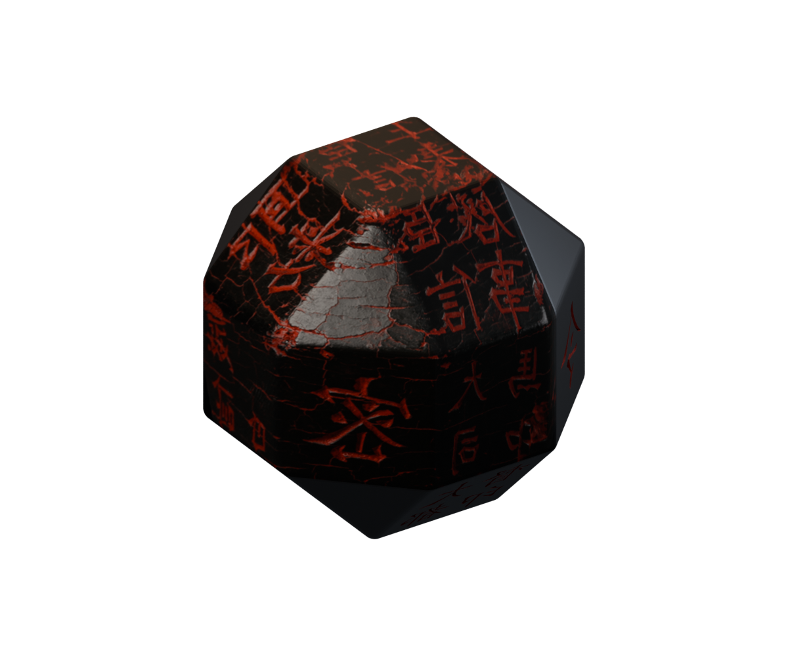
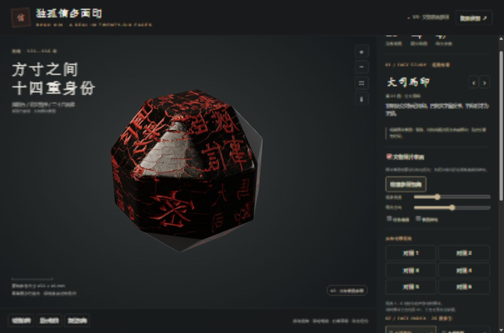
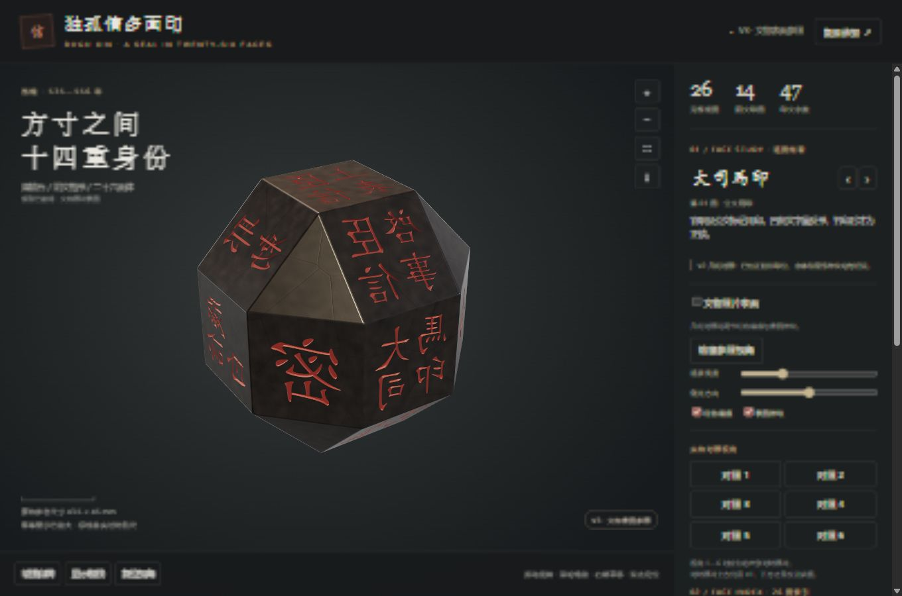
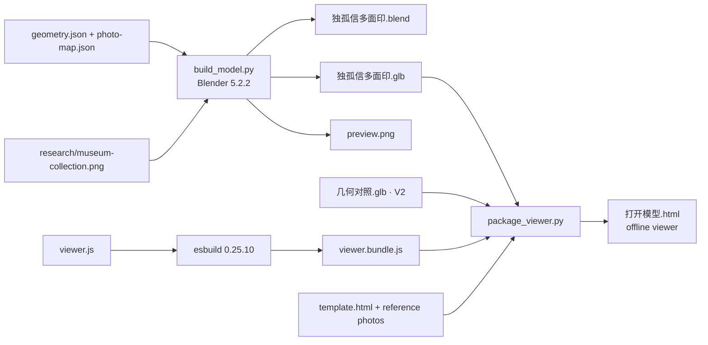
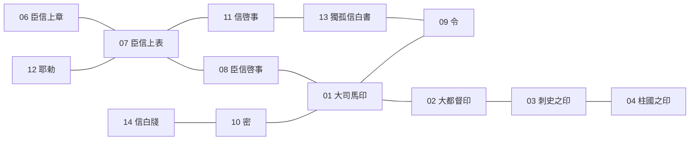
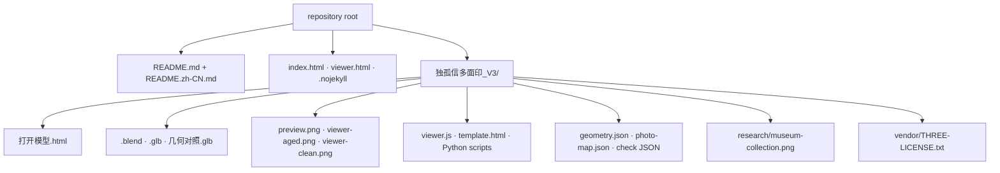
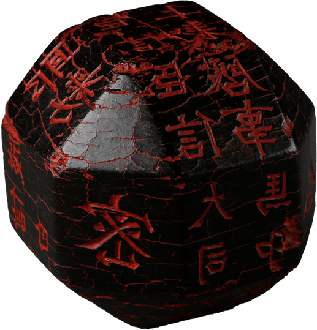
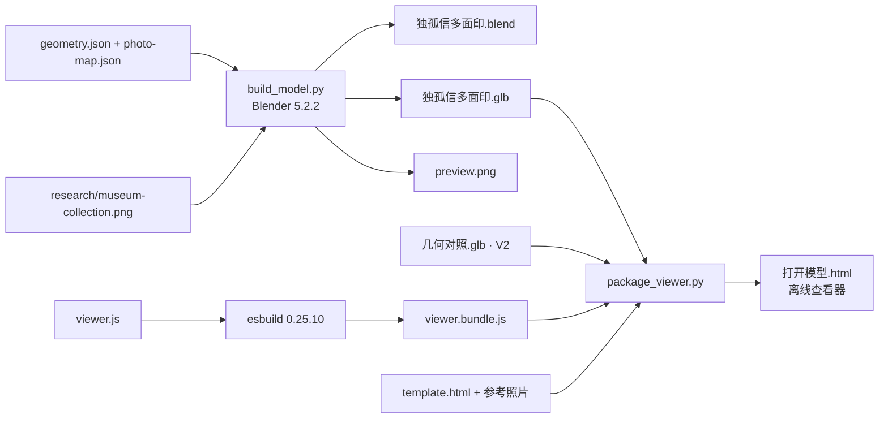

# 独孤信多面印 · Dugu Xin Multi-faceted Seal 3D

[](https://github.com/summerching2012-cyber/-3D-/stargazers)
[](https://github.com/summerching2012-cyber/-3D-/releases)
[](#26-faces)
[](#quick-start)
[](https://www.blender.org/)
[](https://github.com/mrdoob/three.js)

**English** below · **[简体中文全文](README.zh-CN.md)** · 中文在本页后半

<p align="center">
  
</p>

<p align="center">
  <b>Turn a 26-faced seal in your browser.</b> One HTML file, no install, no network.<br>
  双击 <code>独孤信多面印_V3/打开模型.html</code>，用 Chrome 或 Edge 就能转这枚二十六面印。
</p>

<p align="center">
  <a href="https://github.com/summerching2012-cyber/-3D-"><b>★ Star this repo if you want more people to find it</b></a>
  &nbsp;·&nbsp;
  <a href="viewer.html">Open the model</a>
  &nbsp;·&nbsp;
  <a href="https://github.com/summerching2012-cyber/-3D-/archive/refs/heads/main.zip">Download ZIP</a>
</p>

V3 is a **museum-photo reference model** of the Dugu Xin multi-faceted seal (独孤信多面印): 26 faces, 14 intaglio faces, 47 characters. Seven faces that can be seen in the Shaanxi History Museum collection photograph are mapped from that photo. The other faces stay a neutral dark stone, with approximate carved letters where the V2 layout has an inscription. It is a model you can rotate. It is not a photogrammetric or high-precision scan.

<!-- LIVE_DEMO -->

---

## English

### What you can do

- Rotate, zoom and pan a 26-faced solid in Chrome or Edge. The page is one offline file (~35 MB). Three.js 0.180.0 is bundled inside it.
- Switch **文物照片表面** (museum-photo surface, on by default) and the V2 **geometry comparison**.
- Step through all 26 faces, or jump to the six comparison views used to check neighbour faces.
- Open the packed reference pictures from inside the viewer.
- Open the same scene in Blender (`独孤信多面印.blend`, photograph packed in the file).

### Screenshots

| Museum-photo surface | Geometry comparison |
| --- | --- |
|  |  |

`preview.png` is a Blender Cycles still (48 samples, 1200×1000, AgX, transparent background). `viewer-aged.png` and `viewer-clean.png` are browser screenshots of the two modes.

### Quick start

**In the browser**

1. Download the [repository ZIP](https://github.com/summerching2012-cyber/-3D-/archive/refs/heads/main.zip), or the [latest Release](https://github.com/summerching2012-cyber/-3D-/releases) if one is published.
2. Unzip it.
3. Double-click `独孤信多面印_V3/打开模型.html` and open it with **Chrome or Edge**.
4. Left-drag rotates, the wheel zooms, right-drag pans, double-click frames a face. The right-hand index visits every face. Left and right arrow keys move between faces. Home resets the camera.

Nothing is fetched from the network. The V3 model, the V2 comparison model, and 13 reference images are embedded in that HTML file.

**In Blender**

Open `独孤信多面印_V3/独孤信多面印.blend` in **Blender 5.2.2 LTS** (the version recorded in `model-check.json`). The museum image is packed into the `.blend`.

You can also load the glTF files in any glTF viewer:

| File | What it is |
| --- | --- |
| `独孤信多面印.glb` | V3 photo-surface model |
| `几何对照.glb` | V2 model with the full set of approximate incisions |

### Controls

| Action | How |
| --- | --- |
| Rotate / zoom / pan | Left drag / wheel / right drag |
| Frame a face | Double-click, the face index, or ← → |
| Reset | Home, or **复位视角**. **馆藏参照视角** returns to the museum viewing direction (toward 密, 大司馬, 臣信啓事) |
| Photo surface | **文物照片表面**. On by default |
| Red fill and micro-relief | **红色填痕** and **表面微纹**. Active only in geometry mode, so photo pigment is not mistaken for a separate layer |
| Light | **观察亮度** and **侧光方向**. Side light does not move reflections that are already in the photograph |
| Other | Slow spin, facet edges, fullscreen, save the current view as PNG |

### How the model is built



`make_v3.py` and `update_viewer.py` were used to derive these scripts from a sibling V2 folder (`dugu-seal-v2`). That folder is not in this repository. The delivered folder already contains `build_model.py` and `package_viewer.py`, so you do not need to run the derivation scripts.

### 26 faces

Navigation numbers belong to this model. They are not museum accession numbers. Geometry: **18 quadrilaterals + 8 triangles**. Inscriptions are intaglio and **mirrored**, so an impression would read in the normal direction. The sidebar transcription is the normal reading. Letterforms, including 印, are approximate and were not redrawn stroke by stroke.

| # | Name in `geometry.json` | Kind | Sides | V3 surface |
| --- | --- | --- | --- | --- |
| 01 | 大司馬印 | 公文用印 | 4 | Museum photo |
| 02 | 大都督印 | 公文用印 | 4 | Neutral stone, approximate incision |
| 03 | 刺史之印 | 公文用印 | 4 | Neutral stone, approximate incision |
| 04 | 柱國之印 | 公文用印 | 4 | Neutral stone, approximate incision |
| 05 | 臣信上疏 | 上书用印 | 4 | Neutral stone, approximate incision |
| 06 | 臣信上章 | 上书用印 | 4 | Neutral stone, approximate incision |
| 07 | 臣信上表 | 上书用印 | 4 | Museum photo |
| 08 | 臣信啓事 | 上书用印 | 4 | Museum photo |
| 09 | 令 | 公文用印 | 4 | Neutral stone, approximate incision |
| 10 | 密 | 公文用印 | 4 | Museum photo |
| 11 | 信啓事 | 书信用印 | 4 | Neutral stone, approximate incision |
| 12 | 耶勅 | 书信用印 | 4 | Museum photo |
| 13 | 獨孤信白書 | 书信用印 | 4 | Neutral stone, approximate incision |
| 14 | 信白牋 | 书信用印 | 4 | Museum photo; strong side-view squash |
| 15–17 | 三角素面 | 素面 | 3 | Neutral stone |
| 18 | 三角素面 | 素面 | 3 | Museum photo, including glare and cracks |
| 19–20 | 四边素面 | 素面 | 4 | Neutral stone |
| 21–24 | 三角素面 | 素面 | 3 | Neutral stone |
| 25–26 | 四边素面 | 素面 | 4 | Neutral stone |

The sidebar describes the four groups as: official marks (公文用印), documents presented upward (上书用印), letter seals (书信用印), and blank faces (素面).

Neighbour checks below are the six comparison views recorded in `V2修改对照.md` and `layout-check.json`. “Left / right / up / down” depend on how that photo is held. This drawing only shows which faces were checked as neighbours. Faces on the back of the main ring that were not clearly photographed were inferred from the continuous band; that inference is not a full survey.



With 大司馬印 facing you and its text upright, the project’s check puts 密 on the left and 令 on the right, 臣信啓事 above and 大都督印 below. With 臣信上表 facing you, 耶勅 is on the left and 信啓事 on the right. 耶勅 is set in a vertical column. 信啓事 and 信白牋 use two characters in one column and the third character in the other. 獨孤信白書, text upright, has 信啓事 to the left and 令 below; the faces above and to the right are blank.

### What V3 does not claim

- The source photo is **517×539 pixels**. Enlarged detail is limited.
- Corners were matched by hand (`photo-map.json`). The real object is not a perfect 26-faced solid, so some edges and oblique faces stretch.
- Cracks, red residue, wear and glare on the seven photo faces come from the photograph. They have **no measured depth**. Photo faces are not also carved with the approximate Kai font, so the letters are not doubled.
- Closing the photo switch shows all 14 geometric incisions. Those letters are still approximate.
- Replica photographs were used to check **which face sits next to which**, and which way the text points. Replica wear is not treated as museum damage.
- The photo-surface mode uses a slightly wider bevel (about 0.55 mm in the script’s centimetre scene, applied before the mesh is scaled to metres). The notes call this an idealised edge, **not a measured edge**.
- `model-check.json`: Blender 5.2.2 LTS, 19,559 vertices, 19,453 polygons, **0 non-manifold edges**. Dimensions about **43.5 × 43.5 × 45.0 mm**. The viewer prints “43.5 × 45 mm” and says the on-screen scale bar is not a live scale.
- `layout-check.json` records the six adjacency groups and 14 text frames (47 characters) as passing.

### File structure



| Path | Role |
| --- | --- |
| `README.md`, `README.zh-CN.md` | This guide, English and 简体中文 |
| `index.html`, `viewer.html` | Short landing page, and a redirect onto the viewer |
| `独孤信多面印_V3/打开模型.html` | Offline viewer. Double-click this |
| `独孤信多面印_V3/独孤信多面印.blend` | V3 Blender file, image packed |
| `独孤信多面印_V3/独孤信多面印.glb` | V3 glTF |
| `独孤信多面印_V3/几何对照.glb` | V2 glTF kept for the clean comparison |
| `独孤信多面印_V3/preview.png` | Blender still |
| `独孤信多面印_V3/viewer-aged.png`, `viewer-clean.png` | Browser screenshots |
| `独孤信多面印_V3/geometry.json` | 26-face coordinates, labels, text frames |
| `独孤信多面印_V3/photo-map.json` | Shared-corner pixels on the museum image |
| `独孤信多面印_V3/source-manifest.json` | SHA-256 of the 12 local input photos and the museum PNG |
| `独孤信多面印_V3/layout-check.json` | Adjacency and text-frame check |
| `独孤信多面印_V3/model-check.json` | Mesh closure, counts, dimensions |
| `独孤信多面印_V3/viewer-check.json` | Browser pass of both modes |
| `独孤信多面印_V3/delivery-check.json` | V3 delivery hashes; V2 baseline recorded as unchanged |
| `独孤信多面印_V3/build_model.py` | Rebuild the Blend, V3 glTF and preview inside Blender |
| `独孤信多面印_V3/viewer.js`, `template.html` | Viewer source |
| `独孤信多面印_V3/viewer.bundle.js` | esbuild bundle of `viewer.js` plus Three.js |
| `独孤信多面印_V3/package_viewer.py` | Embed models and photos into `打开模型.html` |
| `独孤信多面印_V3/check_layout.py` | Recompute `layout-check.json` |
| `独孤信多面印_V3/make_v3.py`, `update_viewer.py` | Derive V3 scripts from a sibling V2 directory |
| `独孤信多面印_V3/finalize.py` | Hash check and zip. Needs the V2 folder and the original photo paths |
| `独孤信多面印_V3/package.json`, `package-lock.json` | `three` 0.180.0 and `esbuild` 0.25.10 |
| `独孤信多面印_V3/vendor/THREE-LICENSE.txt` | MIT license for Three.js |
| `独孤信多面印_V3/research/museum-collection.png` | Museum collection photo used as the V3 surface |
| `独孤信多面印_V3/README_V3.md`, `使用说明.md`, `V2修改对照.md` | Original V3 notes, kept as delivered |

The 12 local comparison photos listed in `source-manifest.json` are **not** stored as separate files here. They are already embedded in `打开模型.html`. The manifest still contains the absolute paths from the machine that built V3.

### Build from source

Shipped files already run. Rebuild only if you change geometry, the photo map, or the viewer.

**Layout check** (Python 3, NumPy):

```bash
cd 独孤信多面印_V3
python check_layout.py
```

**Model** (Blender 5.2.2, background mode):

```bash
blender --background --python build_model.py
```

`build_model.py` loads KaiTi from `C:/Windows/Fonts/simkai.ttf`. On another system, change that path before carving. It reads `geometry.json`, `photo-map.json` and `research/museum-collection.png`, then writes `独孤信多面印.blend`, `独孤信多面印.glb`, `preview.png` and `model-check.json`. Scene units in the script are centimetres; exported glTF coordinates are metres.

**Viewer bundle** (Node.js; the lockfile pins esbuild 0.25.10 and three 0.180.0):

```bash
npm install
npx esbuild viewer.js --bundle --format=iife --outfile=viewer.bundle.js
```

The original command line was not saved. The command above matches the IIFE bundle that ships, and the imports in `viewer.js`.

**Single-file HTML** (Python 3, Pillow):

```bash
python package_viewer.py
```

This script looks for the comparison JPEGs in the **parent** of `独孤信多面印_V3/` (`*对比图*.jpg`, `独孤信多面印*.jpg`, `食物-独孤信多面印*.jpg`) and adds `research/museum-collection.png`. Those JPEGs are not in this repository. Without them, a fresh HTML file will not contain the 12 reference photos. The HTML file already in the folder does.

`make_v3.py`, `update_viewer.py` and `finalize.py` expect a sibling `dugu-seal-v2` directory and, for `finalize.py`, the original photo paths in `source-manifest.json`. They are kept so the V3 derivation stays visible. They will not run unchanged on a fresh clone.

### Background

The project’s own viewer introduces the object as a **Western Wei (西魏, 535–556)** seal in **煤精** (often translated coal-jade or jet), with **intaglio regular script** on a **26-faced** solid, and a reference size of about 43.5 × 45 mm. This README repeats that framing and does not add a separate historical argument.

V2 (checked 2026-10-01) moved face positions and writing direction using six replica comparison photos, the museum photograph, and published impressions. V3 keeps that layout and maps the museum photo onto the seven faces that photograph shows. Details of each correction are in `V2修改对照.md`. Original V3 notes are in `README_V3.md` and `使用说明.md` (they match).

### Credits and sources

Listed here as the project cites them. Titles follow the viewer and the V3 notes.

- [陕西历史博物馆藏品页](https://www.sxhm.com/collections/detail/439.html) — collection page for the seal.
- [官网原始图片](https://www.sxhm.com/Uploads/Picture/2021/11/10/s618b9af2a3267.png) — image consulted and saved on 2026-10-01 as `research/museum-collection.png`. The V3 notes say copyright remains with the provider. **Rights to redistribute this photograph are not stated, and this repository does not grant them.** See the license section.
- [陕西历史博物馆云展览](https://mec.sxhm.com/) and the exhibition still cited in `V2修改对照.md` (`mec.sxhm.com` image dated 2022-10-14 in that note). Used to check that 密 sits to the left of 大司馬印. That still is not a file in this repo.
- [公开印蜕及释文](https://hk.epochtimes.com/news/2021-04-29/3768105) — cross-check for the columns of 耶勅, 信啓事 and 信白牋. Impressions read normally; the carved face is mirrored. Not a spatial survey.
- [旬阳市人民政府《煤精印》](https://www.xyx.gov.cn/Content-1196101.html) — cited by the viewer for size, face count and 14 inscription groups.
- [陕西历史博物馆《解密多面印》](https://www.sxhm.com/education/detail/18464.html) — cited by the viewer for 煤精 and the 26-face structure.
- [刘钝《独孤信印与秦汉酒骰的几何学》](https://www.dhs.tsinghua.edu.cn/wp-content/uploads/2018/12/Liu_Dun_Du_Gu_Xin_Yin_Yu_Qin_Han_Jiu_Tou_De_Ji_He_Xue.pdf) — geometry reference cited by the viewer.
- [《独孤信多面体印研究新视角》转载](https://www.sohu.com/a/889788027_121124392) — cited by the viewer for inscription groups and neighbours, not as a full survey.
- [Three.js](https://github.com/mrdoob/three.js) — MIT. Packaged locally. See `vendor/THREE-LICENSE.txt`.

<p align="center">
  
</p>

<p align="center"><i>Museum reference photograph, 517×539, saved from the collection page above. Copyright remains with the original provider.</i></p>

### License

- **Three.js**, bundled in `viewer.bundle.js` and `打开模型.html`, is under the MIT License. The notice is in `vendor/THREE-LICENSE.txt` and is also written into the HTML file.
- **`research/museum-collection.png`** is a collection photograph from the Shaanxi History Museum website. The V3 notes say to keep the attribution and that copyright belongs to the original provider. No reuse license is included with the file. Treat the rights as **unclear** before you copy the image into another project, print, or dataset.
- **The Blender file, glTF models, scripts, viewer source and other project text** do not name a license in `README_V3.md` or `使用说明.md`. This repository does not add one. Ask the owner before you reuse those files beyond viewing and studying the model.

### Star

If you enjoyed turning the seal, star the repository. It helps the next person who is looking for a 26-faced seal they can actually hold in a browser.

[★ Star 独孤信多面印 · Dugu Xin Multi-faceted Seal 3D](https://github.com/summerching2012-cyber/-3D-)

---

## 简体中文

完整中文说明也在 [README.zh-CN.md](README.zh-CN.md)。下面是同一份内容，方便只打开本页的读者。

### 能做什么

- 在 Chrome 或 Edge 里旋转、缩放、平移这枚二十六面体。`打开模型.html` 是约 35 MB 的离线单文件，Three.js 0.180.0 已打进页面，不需要联网。
- 默认打开 **文物照片表面**，也可切回 V2 的 **几何对照**。
- 逐面查看 26 个面，或跳到用来核对邻面的六个实物对照视角。
- 在查看器里打开已经内嵌的参考照片。
- 用 Blender 打开 `独孤信多面印.blend`（馆藏照片已打包在文件里）。

### 截图

| 文物照片表面 | 几何对照 |
| --- | --- |
|  |  |

`preview.png` 是 Blender Cycles 静帧（48 采样，1200×1000，AgX，透明背景）。两张 viewer 图是浏览器里两种模式的实际截图。

### 快速开始

**浏览器**

1. 下载[仓库 ZIP](https://github.com/summerching2012-cyber/-3D-/archive/refs/heads/main.zip)，若已发布版本，也可以用 [Release](https://github.com/summerching2012-cyber/-3D-/releases)。
2. 解压。
3. 双击 `独孤信多面印_V3/打开模型.html`，用 **Chrome 或 Edge** 打开。
4. 左键拖拽旋转，滚轮缩放，右键平移，双击某个印面可对准它。右侧索引可逐面查看。左右方向键切换印面，Home 复位。

页面不访问网络。V3 模型、V2 对照模型和 13 张参考图都嵌在这个 HTML 里。

**Blender**

用 **Blender 5.2.2 LTS**（`model-check.json` 记录的版本）打开 `独孤信多面印_V3/独孤信多面印.blend`。

也可以把 glTF 丢进任意 glTF 查看器：`独孤信多面印.glb` 是 V3 照片表面模型，`几何对照.glb` 是带完整近似刻字的 V2 模型。

### 操作

| 动作 | 方法 |
| --- | --- |
| 旋转 / 缩放 / 平移 | 左键拖拽 / 滚轮 / 右键拖拽 |
| 对准某一面 | 双击、右侧索引，或 ← → |
| 复位 | Home，或 **复位视角**。**馆藏参照视角** 回到面向密、大司馬、臣信啓事的方向 |
| 照片表面 | **文物照片表面**，默认开启 |
| 红色填痕、表面微纹 | 只在几何对照模式可用，避免把照片里的颜料和磨损误当成可分离的层 |
| 光线 | **观察亮度**、**侧光方向**。改变侧光不会移动照片里原有的反光 |
| 其他 | 缓慢自转、显示棱线、全屏、把当前视角存成 PNG |

### 模型是怎么来的



`make_v3.py` 和 `update_viewer.py` 从相邻的 V2 目录 `dugu-seal-v2` 派生脚本。那个目录不在本仓库里。交付文件夹里已经有可直接运行的 `build_model.py` 和 `package_viewer.py`。

### 二十六个面

编号只用于本模型导航，不是馆藏编号。几何是 **18 个四边形 + 8 个三角形**。印文是阴文，并且 **反书**，钤盖后才正读；侧栏释文是正读。字形（包括「印」）是近似，没有逐笔重描。

| 编号 | `geometry.json` 中的名称 | 类别 | 边数 | V3 表面 |
| --- | --- | --- | --- | --- |
| 01 | 大司馬印 | 公文用印 | 4 | 馆藏照片 |
| 02 | 大都督印 | 公文用印 | 4 | 中性石色，近似凹刻 |
| 03 | 刺史之印 | 公文用印 | 4 | 中性石色，近似凹刻 |
| 04 | 柱國之印 | 公文用印 | 4 | 中性石色，近似凹刻 |
| 05 | 臣信上疏 | 上书用印 | 4 | 中性石色，近似凹刻 |
| 06 | 臣信上章 | 上书用印 | 4 | 中性石色，近似凹刻 |
| 07 | 臣信上表 | 上书用印 | 4 | 馆藏照片 |
| 08 | 臣信啓事 | 上书用印 | 4 | 馆藏照片 |
| 09 | 令 | 公文用印 | 4 | 中性石色，近似凹刻 |
| 10 | 密 | 公文用印 | 4 | 馆藏照片 |
| 11 | 信啓事 | 书信用印 | 4 | 中性石色，近似凹刻 |
| 12 | 耶勅 | 书信用印 | 4 | 馆藏照片 |
| 13 | 獨孤信白書 | 书信用印 | 4 | 中性石色，近似凹刻 |
| 14 | 信白牋 | 书信用印 | 4 | 馆藏照片，侧视压缩明显 |
| 15–17 | 三角素面 | 素面 | 3 | 中性石色 |
| 18 | 三角素面 | 素面 | 3 | 馆藏照片，含可见反光与裂隙 |
| 19–20 | 四边素面 | 素面 | 4 | 中性石色 |
| 21–24 | 三角素面 | 素面 | 3 | 中性石色 |
| 25–26 | 四边素面 | 素面 | 4 | 中性石色 |

查看器对四类的说明是：公文用印为官职及公文标记；上书用印含上疏、上章、上表与启事；书信用印显示姓名和行文用语；素面无印文。

下面这张图对应 `V2修改对照.md` 和 `layout-check.json` 里的六组邻接。左右上下取决于那张照片怎么拿。图里只表示「核对过彼此相邻」，不是一张展开图。主环上没拍清的背面，项目说明里写的是按相邻顺序和连续环带推定，并不声称做了全周测绘。


以「大司馬印」为正面、文字朝上时：左「密」、右「令」，上「臣信啓事」、下「大都督印」。以「臣信上表」为正面时：左「耶勅」、右「信啓事」。「耶勅」为竖排。「信啓事」「信白牋」是前两字一列、第三字另列。「獨孤信白書」字朝上时，左邻「信啓事」，下邻「令」，上、右为素面。

### V3 没有声称的事

- 源图只有 **517×539 像素**，放大后细节有限。
- 角点是手工对应（`photo-map.json`）。原件不是理想的二十六面体，部分棱边和斜面会拉伸。
- 七个照片面上的裂隙、红色残留、擦损和反光来自照片，**没有实测立体深度**。这些面不再叠加楷体凹刻，以免双重字影。
- 关掉照片模式可以看到全部 14 面几何凹刻，字体仍然是近似。
- 复制品照片只用来核对 **印位和字向**。不把复制品表面当成馆藏磨损。
- 照片表面模式用了略宽的圆角（脚本在厘米场景里约 0.55 mm，缩放成米之前施加）。说明里写明这是理想化外形，**不是原件边缘测量**。
- `model-check.json`：Blender 5.2.2 LTS，19,559 顶点，19,453 面，**非流形边为 0**。尺寸约 **43.5 × 43.5 × 45.0 mm**。查看器界面写作「43.5 × 45 mm」，并注明屏幕标线不是实时比例尺。
- `layout-check.json` 记录六组邻接和 14 个文字坐标系（47 字）通过检查。

### 文件结构

| 路径 | 作用 |
| --- | --- |
| `README.md`、`README.zh-CN.md` | 本说明的英中双语 |
| `index.html`、`viewer.html` | 简短介绍页，以及跳转到查看器的页面 |
| `独孤信多面印_V3/打开模型.html` | 离线查看器，双击这个 |
| `独孤信多面印_V3/独孤信多面印.blend` | V3 Blender 文件，图像已打包 |
| `独孤信多面印_V3/独孤信多面印.glb` | V3 glTF |
| `独孤信多面印_V3/几何对照.glb` | 保留的 V2 完整刻字对照 |
| `独孤信多面印_V3/preview.png` | Blender 静帧 |
| `独孤信多面印_V3/viewer-aged.png`、`viewer-clean.png` | 浏览器截图 |
| `独孤信多面印_V3/geometry.json` | 26 面坐标、印文、文字坐标系 |
| `独孤信多面印_V3/photo-map.json` | 馆藏照片上的共享角点像素 |
| `独孤信多面印_V3/source-manifest.json` | 12 张本地输入照片和馆藏 PNG 的 SHA-256 |
| `独孤信多面印_V3/layout-check.json` | 邻接与字向检查 |
| `独孤信多面印_V3/model-check.json` | 网格闭合、数量、尺寸 |
| `独孤信多面印_V3/viewer-check.json` | 两种模式的浏览器检查 |
| `独孤信多面印_V3/delivery-check.json` | V3 交付哈希；记录 V2 基线未改 |
| `独孤信多面印_V3/build_model.py` | 在 Blender 里重建 blend、V3 glTF 和预览图 |
| `独孤信多面印_V3/viewer.js`、`template.html` | 查看器源文件 |
| `独孤信多面印_V3/viewer.bundle.js` | `viewer.js` 与 Three.js 的 esbuild 打包结果 |
| `独孤信多面印_V3/package_viewer.py` | 把模型和照片嵌进 `打开模型.html` |
| `独孤信多面印_V3/check_layout.py` | 重算 `layout-check.json` |
| `独孤信多面印_V3/make_v3.py`、`update_viewer.py` | 从相邻 V2 目录派生 V3 脚本 |
| `独孤信多面印_V3/finalize.py` | 校验哈希并打包。需要 V2 目录和原始照片路径 |
| `独孤信多面印_V3/package.json`、`package-lock.json` | `three` 0.180.0 与 `esbuild` 0.25.10 |
| `独孤信多面印_V3/vendor/THREE-LICENSE.txt` | Three.js 的 MIT 许可 |
| `独孤信多面印_V3/research/museum-collection.png` | 用作 V3 表面的馆藏照片 |
| `独孤信多面印_V3/README_V3.md`、`使用说明.md`、`V2修改对照.md` | 原始说明，按交付原样保留 |

`source-manifest.json` 里的 12 张本地对比照片 **没有** 作为单独文件放进仓库，它们已经嵌在 `打开模型.html` 里。清单里仍保留构建那台电脑上的绝对路径。

### 从源码构建

仓库里的成品可以直接打开。只有在改了几何、照片贴图或查看器时才需要重建。

**印位检查**（Python 3，需要 NumPy）：

```bash
cd 独孤信多面印_V3
python check_layout.py
```

**模型**（Blender 5.2.2 后台模式）：

```bash
blender --background --python build_model.py
```

`build_model.py` 从 `C:/Windows/Fonts/simkai.ttf` 读取楷体。换一台电脑要先改这个路径。脚本读取 `geometry.json`、`photo-map.json` 和 `research/museum-collection.png`，写出 `独孤信多面印.blend`、`独孤信多面印.glb`、`preview.png` 和 `model-check.json`。脚本里的场景单位是厘米，导出的 glTF 坐标是米。

**查看器打包**（Node.js；锁文件固定 esbuild 0.25.10 和 three 0.180.0）：

```bash
npm install
npx esbuild viewer.js --bundle --format=iife --outfile=viewer.bundle.js
```

当时的原始命令没有记在项目里。上面这条和现成的 IIFE 打包结果、以及 `viewer.js` 的导入方式一致。

**单文件 HTML**（Python 3，需要 Pillow）：

```bash
python package_viewer.py
```

脚本会到 `独孤信多面印_V3/` 的 **上一级目录** 找对比图（`*对比图*.jpg`、`独孤信多面印*.jpg`、`食物-独孤信多面印*.jpg`），并加入 `research/museum-collection.png`。那些 JPEG 不在本仓库里。没有它们，重新打包的 HTML 就不会包含那 12 张参考照片。文件夹里现成的 HTML 已经包含。

`make_v3.py`、`update_viewer.py` 和 `finalize.py` 需要相邻的 `dugu-seal-v2` 目录；`finalize.py` 还要 `source-manifest.json` 里的原始照片路径。文件保留是为了让 V3 的派生过程可查。新克隆下来不能原样跑通。

### 背景

查看器自己把这件器物写成 **西魏（535–556）** 的 **煤精** 印，**阴文楷书**，**二十六面**，参考尺寸约 43.5 × 45 mm。本说明沿用项目里的这个表述，不另加一套考证。

V2 在 2026-10-01 根据六张复制品对比照片、馆藏照片和公开印蜕，改正了印位和字向。V3 保留这套面位，把馆藏照片贴到照片里能辨认的 7 个面上。每处改正写在 `V2修改对照.md`。原始 V3 说明在 `README_V3.md` 和 `使用说明.md`（两份内容相同）。

### 出处

按项目自己的引用列出。

- [陕西历史博物馆藏品页](https://www.sxhm.com/collections/detail/439.html)
- [官网原始图片](https://www.sxhm.com/Uploads/Picture/2021/11/10/s618b9af2a3267.png)，查阅并保存于 2026-10-01，文件为 `research/museum-collection.png`。V3 说明写明版权归原提供方。**照片能否再分发，项目没有给出授权，本仓库也不授予。** 见下方许可。
- [陕西历史博物馆云展览](https://mec.sxhm.com/)，以及 `V2修改对照.md` 引用的云展览静帧，用来核对「密」在「大司馬印」左侧。那张静帧不在本仓库文件中。
- [公开印蜕及释文](https://hk.epochtimes.com/news/2021-04-29/3768105)，用来交叉核对「耶勅」「信啓事」「信白牋」的行列。印蜕正读，刻面须镜像。不是空间测绘。
- [旬阳市人民政府《煤精印》](https://www.xyx.gov.cn/Content-1196101.html)，查看器用来引用尺寸、面数和 14 组印文。
- [陕西历史博物馆《解密多面印》](https://www.sxhm.com/education/detail/18464.html)，查看器用来引用煤精材质和 26 面结构。
- [刘钝《独孤信印与秦汉酒骰的几何学》](https://www.dhs.tsinghua.edu.cn/wp-content/uploads/2018/12/Liu_Dun_Du_Gu_Xin_Yin_Yu_Qin_Han_Jiu_Tou_De_Ji_He_Xue.pdf)，查看器列出的几何参考。
- [《独孤信多面体印研究新视角》转载](https://www.sohu.com/a/889788027_121124392)，查看器用来参考印文分组和相邻关系，不是全周测绘。
- [Three.js](https://github.com/mrdoob/three.js)，MIT，已本地打包。见 `vendor/THREE-LICENSE.txt`。

### 许可

- **Three.js**（在 `viewer.bundle.js` 和 `打开模型.html` 里）使用 MIT 许可。全文在 `vendor/THREE-LICENSE.txt`，也写进了 HTML。
- **`research/museum-collection.png`** 是陕西历史博物馆官网藏品照片。V3 说明要求保留出处，并写明版权归原提供方。文件本身没有附带再利用许可。在把它复制到别的项目、印刷品或数据集之前，请把权利状况视为 **不明确**。
- **Blender 文件、glTF、脚本、查看器源码和其余项目文字** 在 `README_V3.md` 与 `使用说明.md` 里没有指定许可证。本仓库也不另外添加。除了查看和学习这个模型，再使用这些文件前请先问仓库所有者。

### 加一颗星

如果转这枚印的时候觉得有意思，给仓库加一颗星。下一个人要找一枚能在浏览器里拿在手里转的二十六面印时，会更容易遇见它。

[★ 给「独孤信多面印 · Dugu Xin Multi-faceted Seal 3D」加星](https://github.com/summerching2012-cyber/-3D-)
