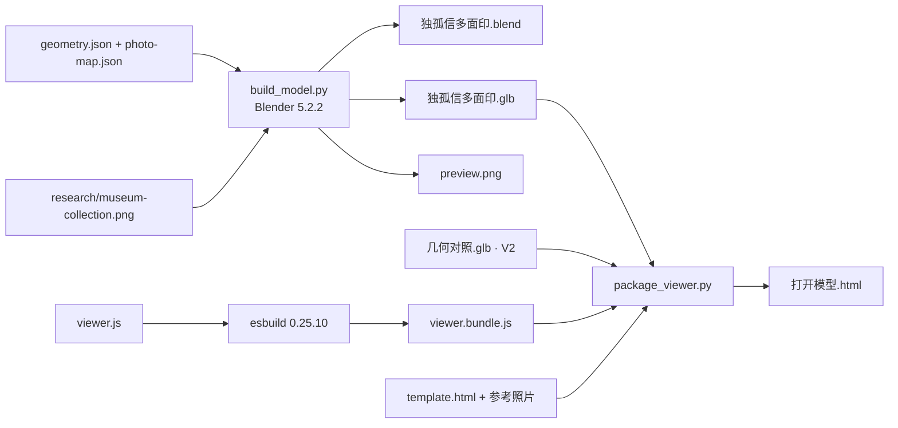
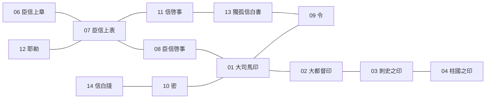

# 独孤信多面印 · Dugu Xin Multi-faceted Seal 3D

[English](README.md) · 简体中文

[](https://github.com/summerching2012-cyber/-3D-/stargazers)
[](https://github.com/summerching2012-cyber/-3D-/releases)
[](#二十六个面)
[](#快速开始)
[](https://www.blender.org/)
[](https://github.com/mrdoob/three.js)

<p align="center">
  
</p>

<p align="center">
  <b>在浏览器里转动这枚二十六面印。</b> 一个 HTML 文件，不用安装，不用联网。<br>
  Double-click <code>独孤信多面印_V3/打开模型.html</code> in Chrome or Edge.
</p>

<p align="center">
  <a href="https://github.com/summerching2012-cyber/-3D-"><b>★ 觉得有意思就加一颗星</b></a>
  &nbsp;·&nbsp;
  <a href="viewer.html">打开模型</a>
  &nbsp;·&nbsp;
  <a href="https://github.com/summerching2012-cyber/-3D-/archive/refs/heads/main.zip">下载 ZIP</a>
</p>

这是独孤信多面印的 **V3 文物表面参照模型**：26 个面，14 个阴文印面，47 个字。陕西历史博物馆官网藏品照片里能辨认的 7 个面，按共享棱角贴上了这张照片。其余面用中性黑褐石色；V2 布局里有印文的面保留近似凹刻。它可以旋转着看。它不是全周摄影测量，也不是高精度文物扫描。

英文说明在 [README.md](README.md)。原始交付说明仍在 `独孤信多面印_V3/README_V3.md` 与 `使用说明.md`。

<!-- LIVE_DEMO -->

## 能做什么

- 在 Chrome 或 Edge 里旋转、缩放、平移。`打开模型.html` 约 35 MB，Three.js 0.180.0 已打包在页面里。
- 默认是 **文物照片表面**，可以关掉，回到 V2 **几何对照**。
- 用右侧索引逐面看，或用六个实物对照视角核对邻面。
- 在页面里翻已经嵌进去的参考照片。
- 用 Blender 打开 `独孤信多面印.blend`。馆藏照片已经打包在 blend 文件里。

## 截图

| 文物照片表面 | 几何对照 |
| --- | --- |
|  |  |

`preview.png` 是 Blender Cycles 静帧（48 采样，1200×1000，AgX，透明背景）。上面两张是浏览器实际截图。

## 快速开始

1. 下载[仓库 ZIP](https://github.com/summerching2012-cyber/-3D-/archive/refs/heads/main.zip)。如果发布了版本，用 [Release](https://github.com/summerching2012-cyber/-3D-/releases) 也行。
2. 解压。
3. 双击 `独孤信多面印_V3/打开模型.html`，用 **Chrome 或 Edge** 打开。
4. 左键拖拽旋转，滚轮缩放，右键平移，双击印面对准该面。左右方向键切换，Home 复位。

不需要本地服务器。V3 模型、V2 对照模型和 13 张参考图都在这个文件里。

用 **Blender 5.2.2 LTS** 打开 `独孤信多面印_V3/独孤信多面印.blend`（版本记在 `model-check.json`）。`独孤信多面印.glb` 是 V3 照片表面模型，`几何对照.glb` 是 V2 完整近似刻字模型。

## 操作

| 动作 | 方法 |
| --- | --- |
| 旋转 / 缩放 / 平移 | 左键拖拽 / 滚轮 / 右键拖拽 |
| 对准某一面 | 双击、右侧索引，或 ← → |
| 复位 | Home，或 **复位视角**。**馆藏参照视角** 面向密、大司馬、臣信啓事 |
| 照片表面 | **文物照片表面**，默认开着 |
| 红色填痕、表面微纹 | 只在几何模式能开，避免把照片里的颜料当成单独一层 |
| 光线 | **观察亮度**、**侧光方向**。侧光移不动照片里原来的反光 |
| 其他 | 缓慢自转、棱线、全屏、保存当前视角 PNG |

## 从 Blender 到网页



`make_v3.py`、`update_viewer.py` 从相邻目录 `dugu-seal-v2` 派生脚本。那个目录不在本仓库。现成的 `build_model.py` 和 `package_viewer.py` 可以直接用。

## 二十六个面

编号是模型导航号，不是馆藏编号。**18 个四边形 + 8 个三角形**。阴文反书，钤出来才正读；侧栏是正读释文。字形含「印」在内都是近似，没有逐笔重描。

| 编号 | 名称 | 类别 | 边数 | V3 表面 |
| --- | --- | --- | --- | --- |
| 01 | 大司馬印 | 公文用印 | 4 | 馆藏照片 |
| 02 | 大都督印 | 公文用印 | 4 | 中性石色，近似凹刻 |
| 03 | 刺史之印 | 公文用印 | 4 | 中性石色，近似凹刻 |
| 04 | 柱國之印 | 公文用印 | 4 | 中性石色，近似凹刻 |
| 05 | 臣信上疏 | 上书用印 | 4 | 中性石色，近似凹刻 |
| 06 | 臣信上章 | 上书用印 | 4 | 中性石色，近似凹刻 |
| 07 | 臣信上表 | 上书用印 | 4 | 馆藏照片 |
| 08 | 臣信啓事 | 上书用印 | 4 | 馆藏照片 |
| 09 | 令 | 公文用印 | 4 | 中性石色，近似凹刻 |
| 10 | 密 | 公文用印 | 4 | 馆藏照片 |
| 11 | 信啓事 | 书信用印 | 4 | 中性石色，近似凹刻 |
| 12 | 耶勅 | 书信用印 | 4 | 馆藏照片 |
| 13 | 獨孤信白書 | 书信用印 | 4 | 中性石色，近似凹刻 |
| 14 | 信白牋 | 书信用印 | 4 | 馆藏照片，侧视压缩明显 |
| 15–17 | 三角素面 | 素面 | 3 | 中性石色 |
| 18 | 三角素面 | 素面 | 3 | 馆藏照片，含反光与裂隙 |
| 19–20 | 四边素面 | 素面 | 4 | 中性石色 |
| 21–24 | 三角素面 | 素面 | 3 | 中性石色 |
| 25–26 | 四边素面 | 素面 | 4 | 中性石色 |

查看器里的四类说明：公文用印是官职及公文标记；上书用印含上疏、上章、上表与启事；书信用印显示姓名和行文用语；素面没有印文。

六组邻接来自 `V2修改对照.md` 和 `layout-check.json`。左右上下随照片的拿法改变。下图只表示核对过的相邻关系。没拍清的主环背面，说明里写的是按连续环带推定。



「大司馬印」朝前、文字朝上：左密、右令，上臣信啓事、下大都督印。「臣信上表」朝前：左耶勅、右信啓事。耶勅竖排。信啓事、信白牋是两字一列、第三字另列。獨孤信白書字朝上时，左是信啓事，下是令，上、右是素面。

## 边界

- 源图 **517×539**，放大后细节有限。角点是手工对应，棱边和斜面可能拉伸。
- 照片上的裂隙、红痕、擦损、反光没有实测深度。贴了照片的面不再叠加楷体凹刻。
- 几何模式的 14 面凹刻仍是近似字体。复制品只核对印位和朝向，不代替馆藏磨损。
- 照片模式的圆角略宽（厘米场景里约 0.55 mm，再缩放到米），说明里写明不是实测边缘。
- `model-check.json`：Blender 5.2.2 LTS，19,559 顶点，19,453 面，非流形边 0，尺寸约 43.5 × 43.5 × 45.0 mm。界面写作「43.5 × 45 mm」，标线不是实时比例尺。
- `layout-check.json`：六组邻接、14 个文字坐标系、47 字，检查通过。

## 文件

| 路径 | 作用 |
| --- | --- |
| `打开模型.html` | 离线查看器，双击 |
| `独孤信多面印.blend` | V3 模型，图像已打包 |
| `独孤信多面印.glb` / `几何对照.glb` | V3 照片表面 / V2 刻字对照 |
| `preview.png`、`viewer-aged.png`、`viewer-clean.png` | 渲染图和浏览器截图 |
| `geometry.json`、`photo-map.json` | 面位与照片角点 |
| `source-manifest.json` | 12 张本地照片和馆藏图的 SHA-256 |
| `layout-check.json`、`model-check.json`、`viewer-check.json`、`delivery-check.json` | 检查记录 |
| `build_model.py`、`viewer.js`、`template.html`、`package_viewer.py`、`viewer.bundle.js` | 构建与查看器源码 |
| `check_layout.py`、`make_v3.py`、`update_viewer.py`、`finalize.py` | 校验，以及从 V2 派生、打包的脚本 |
| `research/museum-collection.png` | 馆藏参照照片 |
| `vendor/THREE-LICENSE.txt` | Three.js MIT 许可 |
| `README_V3.md`、`使用说明.md`、`V2修改对照.md` | 原始说明 |

以上路径都在 `独孤信多面印_V3/` 里。12 张本地对比照片没有单独提交，已经嵌在 HTML 中。`source-manifest.json` 里还留着构建电脑上的绝对路径。

## 从源码构建

成品可以直接打开。要重建时：

```bash
cd 独孤信多面印_V3
python check_layout.py
blender --background --python build_model.py
npm install
npx esbuild viewer.js --bundle --format=iife --outfile=viewer.bundle.js
python package_viewer.py
```

- `check_layout.py` 需要 NumPy。
- `build_model.py` 需要 Blender 5.2.2，并从 `C:/Windows/Fonts/simkai.ttf` 读楷体。别的系统要改字体路径。场景单位是厘米，glTF 是米。
- esbuild 的原始命令没有记下来。上面这条和现成的 IIFE 打包一致。锁文件是 esbuild 0.25.10、three 0.180.0。
- `package_viewer.py` 需要 Pillow，并且到 **上一级目录** 找那 12 张 JPEG。JPEG 不在本仓库，所以不能只靠克隆重新打出带参考照片的 HTML。现成的 HTML 已经带好了。
- `make_v3.py`、`update_viewer.py`、`finalize.py` 需要相邻的 `dugu-seal-v2`。`finalize.py` 还要清单里的原始路径。保留它们是为了看清 V3 怎么从 V2 来，新克隆不能原样运行。

## 背景与出处

查看器把器物写成西魏（535–556）煤精印，阴文楷书，二十六面，参考尺寸约 43.5 × 45 mm。这里沿用这个说法，不另作考证。V2 校对日期是 2026-10-01。逐项改正见 `V2修改对照.md`。

- [陕西历史博物馆藏品页](https://www.sxhm.com/collections/detail/439.html)
- [官网原始图片](https://www.sxhm.com/Uploads/Picture/2021/11/10/s618b9af2a3267.png)，2026-10-01 查阅保存为 `research/museum-collection.png`。版权归原提供方。再分发权利不明确，本仓库不授予。
- [陕西历史博物馆云展览](https://mec.sxhm.com/)，以及 `V2修改对照.md` 引用的静帧，用来核对「密」在「大司馬印」左侧。
- [公开印蜕及释文](https://hk.epochtimes.com/news/2021-04-29/3768105)。印蜕正读，刻面镜像。
- [旬阳市人民政府《煤精印》](https://www.xyx.gov.cn/Content-1196101.html)
- [陕西历史博物馆《解密多面印》](https://www.sxhm.com/education/detail/18464.html)
- [刘钝《独孤信印与秦汉酒骰的几何学》](https://www.dhs.tsinghua.edu.cn/wp-content/uploads/2018/12/Liu_Dun_Du_Gu_Xin_Yin_Yu_Qin_Han_Jiu_Tou_De_Ji_He_Xue.pdf)
- [《独孤信多面体印研究新视角》转载](https://www.sohu.com/a/889788027_121124392)
- [Three.js](https://github.com/mrdoob/three.js)，MIT

<p align="center">
  
</p>

## 许可

- Three.js 为 MIT，见 `vendor/THREE-LICENSE.txt`。
- 馆藏照片版权归原提供方，权利状况不明确。
- 模型、脚本和查看器源码在原始说明里没有许可证。本仓库不补加。除查看和学习外，再使用前请询问仓库所有者。

## 加一颗星

转过这枚印，如果还想让下一个人也找到它，就给仓库加一颗星。

[★ 独孤信多面印 · Dugu Xin Multi-faceted Seal 3D](https://github.com/summerching2012-cyber/-3D-)
